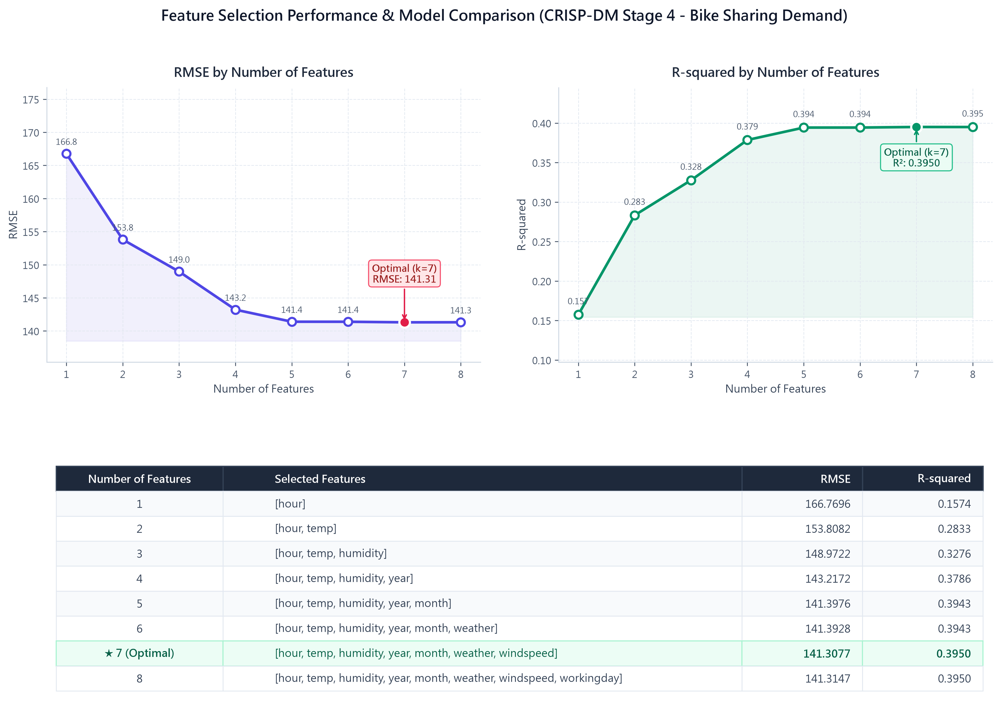
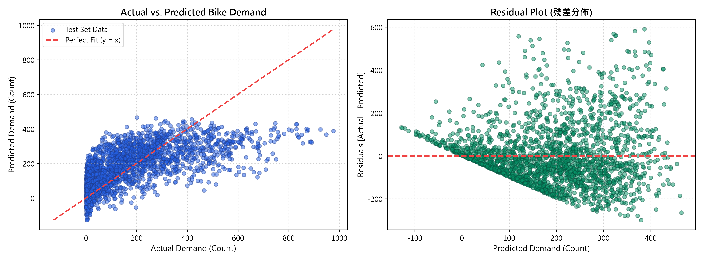

# Kaggle Bike Sharing Demand 共享單車需求預測系統
> **遵循 CRISP-DM 跨產業數據探勘標準流程之機器學習分析與互動式決策平台**

---

🔗 **線上互動網站 (Live Demo)：** https://dorachang0402.github.io/AIIS_HM2_1019/

---

## 📸 網站與分析儀表板截圖



*▲ CRISP-DM 階段 4：特徵數量消長實驗與模型比較儀表板（RMSE 與 R² 變化趨勢圖及最優 7 特徵組合評估表）*

<br>



*▲ CRISP-DM 階段 5：模型評估擬合散佈圖（左：測試集實際值 vs 預測值，紅虛線為理想 y=x）與殘差檢驗圖（右：均勻對稱分佈）*

---

## 📖 專案介紹

### 專案簡介與製作目的
本專案為人工智慧碩專班「**人工智慧與資訊安全 (AIIS)**」課程專題實作（作業二），針對知名 Kaggle 競賽 **[Bike Sharing Demand](https://www.kaggle.com/c/bike-sharing-demand)** 進行端到端（End-to-End）的機器學習與迴歸分析。

共享單車系統的調度效率高度取決於對未來用車需求的精準預測。為克服傳統資料探勘缺乏系統化架構之痛點，本專案嚴格遵循國際通用的 **CRISP-DM (Cross-Industry Standard Process for Data Mining)** 跨產業數據探勘方法論，將完整的分析流程拆解為 6 大標準步驟，並進一步開發出**完全獨立、支援離線執行的互動式決策網頁平台**，讓決策者與工程師能直觀探索特徵關係並進行即時用車量模擬。

---

## 🚀 CRISP-DM 流程與主要功能

本系統涵蓋完整的 CRISP-DM 6 大階段核心功能：

### 1. 商業理解 (Business Understanding)
- **業務痛點剖析**：分析無車可借（流失用戶）與車位不足（調度成本飆升）之營運挑戰。
- **競賽評估指標**：對齊 Kaggle 官方評分指標 **RMSLE (Root Mean Squared Logarithmic Error)**，重視預測比例誤差而非絕對數值。

### 2. 資料理解 (Data Understanding)
- **真實數據整合**：納入 10,886 筆訓練集數據，提供首頁即時數據表檢索與分頁瀏覽。
- **特徵相關性視覺化**：動態呈現各項特徵與目標變數 `count` 之皮爾森相關係數（如 `hour` 通勤尖峰相關性高達 **+0.401**，`temp` 氣溫達 **+0.394**）。

### 3. 資料準備 (Data Preparation)
- **時間維度特徵提取**：從原始 `datetime` 字串精準分解出小時（`hour`）、月份（`month`）、年份（`year`）與星期（`dayofweek`）。
- **目標變數 Log1p 對數轉換**：針對原始 `count` 高度右偏態分佈（Right-skewed），採用 $y_{\text{log}} = \ln(1 + \text{count})$ 進行訓練，壓抑極端值過度懲罰，並以 $\hat{y}_{\text{orig}} = \exp(\hat{y}) - 1$ 保證預測值恆 $\ge 0$。
- **防止多重共線性**：偵測到 `temp` 與 `atemp` 相關係數高達 0.985，主動剔除冗餘欄位 `atemp` 以提升矩陣數值穩定性。
- **資料集切分**：嚴格採 80/20 劃分訓練集（8,708 筆）與獨立測試集（2,178 筆），杜絕資料洩漏。

### 4. 特徵選取與建模 (Modeling & Feature Selection)
- **特徵消長實驗 ($k=1 \sim 8$)**：依據特徵重要性排序，逐步遞增特徵數量進行複迴歸實驗。
- **最佳模型定位**：驗證顯示在納入 7 個特徵時達到最優平衡點（$k=7$: `hour`, `temp`, `humidity`, `year`, `month`, `weather`, `windspeed`，**RMSE 達 141.31**、$R^2 = 0.395$）。

### 5. 模型評估 (Evaluation)
- **多模型評估比對**：
  - 多元線性迴歸 (Linear Regression)
  - 脊迴歸 (Ridge Regression)
  - 隨機森林迴歸 (Random Forest Regressor, 100 棵決策樹集成，搭配 Log1p 轉換)
- **殘差與擬合分佈診斷**：提供 Actual vs. Predicted 散佈圖與殘差對稱分佈圖，驗證隨機森林模型之優異泛化能力。

### 6. 模型部署與即時預測 (Deployment & Simulator)
- **互動式單車需求模擬器**：支援即時自訂調整時段（0~23 時）、溫度、濕度、風速、季節、天候狀態與工作日設定。
- **微秒級前端推論**：無需等待後端伺服器回應，直接於瀏覽器運算預測租借總量，並提供動態備車調度警示。
- **明暗雙主題支援**：支援深色 (Dark Mode) 與淺色 (Light Mode) 現代玻璃擬態介面切換。

---

## 🛠️ 使用技術

| 領域 | 技術項目 | 說明 |
| :--- | :--- | :--- |
| **數據科學 / 演算法** | **Python 3.10+** | 核心演算法與實驗腳本開發 |
| | **scikit-learn** | 機器學習模型訓練（Linear Regression、Ridge、Random Forest）、評估指標（MAE、MSE、RMSE、R²） |
| | **pandas & numpy** | 數據清洗、時序特徵工程、對數轉換（`np.log1p` / `np.expm1`） |
| | **matplotlib** | 模型消長實驗與殘差評估圖表生成 |
| **前端應用 / 視覺化** | **HTML5 & CSS3** | 響應式介面設計 (RWD)、純 CSS 數學公式排版、CSS 變數明暗主題 |
| | **Vanilla JavaScript (ES6+)** | 無前端框架依賴，純原生實現切換導覽、表格分頁、即時推論運算 |
| | **Chart.js 4.4.8 (UMD)** | 封裝本機離線版本，繪製即時折線圖、長條圖與散佈圖 |

---

## 💻 安裝與執行方式

### 專案目錄結構
```text
HM2/
├── index.html                     # CRISP-DM 互動式決策平台主頁面
├── style.css                      # 現代化設計系統、明暗主題與公式樣式
├── app.js                         # 前端互動邏輯、Chart.js 圖表與預測模擬器
├── bike_data.js                   # 預先處理之數據與模型權重 (離線支援)
├── bike_data.json                 # 結構化資料集備份
├── chart.umd.min.js               # 本機離線版 Chart.js 函式庫
├── main.py                        # CRISP-DM 完整 Python 機器學習分析腳本
├── train.csv                      # Kaggle 原始訓練資料集
├── test.csv                       # Kaggle 原始測試資料集
├── feature_selection_dashboard.png # 階段 4：特徵選取儀表板截圖
└── model_evaluation_plots.png     # 階段 5：模型評估與殘差檢驗圖
```

---

### 方式一：直接預覽互動網頁（最簡易，無需任何環境）
本專案已將 Chart.js 函式庫與核心分析數據整合為本機離線資源：
1. 下載或複製本儲存庫到本機。
2. 進入專案資料夾，**直接以任何瀏覽器雙擊開啟 `index.html`** 即可立即體驗完整的 CRISP-DM 互動儀表板。

---

### 方式二：透過本機 HTTP 伺服器預覽
若希望透過本機 HTTP 服務瀏覽，可使用 Python 內建指令：
```powershell
# 進入專案目錄
cd "path/to/HM2"

# 啟動本機伺服器
python -m http.server 8000
```
啟動後開啟瀏覽器造訪：`http://localhost:8000`

---

### 方式三：執行 Python 機器學習分析 (`main.py`)
若欲重現完整的機器學習訓練、特徵篩選實驗並重新產生圖表：

1. **安裝相依套件**：
   ```bash
   pip install numpy pandas scikit-learn matplotlib
   ```

2. **執行分析腳本**：
   ```bash
   python main.py
   ```
   執行完成後將依序印出 CRISP-DM 6 步驟詳細統計數據，並於目錄下生成最新之分析圖檔。
